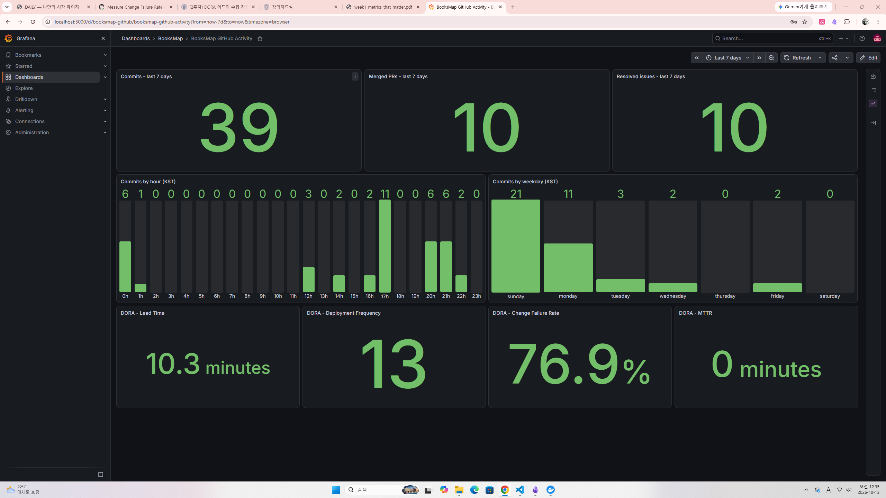
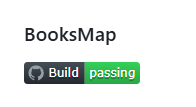

# 2주차 과제
## 과제 2 메트릭 대시보드 구축

## 과제 주제

Prometheus·Grafana 기반 개발 메트릭 대시보드 구축

## 구현 내용

- Docker Compose로 Prometheus와 Grafana 실행
- GitHub API 기반 메트릭 수집
- Prometheus `/api/metrics` 엔드포인트 제공
- GitHub 활동 지표와 DORA 4대 지표 시각화

## 관련 파일

### 워크플로우

- [배포 빈도 워크플로우](../.github/workflows/deployment-frequency.yml)
- [배포 추적 워크플로우](../.github/workflows/deployment-tracker.yml)
- [Health Check 워크플로우](../.github/workflows/health-check.yml)
- [MTTR 워크플로우](../.github/workflows/mttr.yml)
- [변경 실패율 워크플로우](../.github/workflows/change-failure-rate.yml)

### 문서

- [모니터링 도구 및 API 명세서](../docs/monitoring-tools.md)
- [배포 빈도 문서](../docs/workflows/deployment-frequency.md)
- [Health Check 문서](../docs/workflows/health-check.md)
- [MTTR 문서](../docs/workflows/mttr.md)
- [변경 실패율 문서](../docs/workflows/change-failure-rate.md)

### 주요 구현 파일

- [Docker Compose 설정](../docker-compose.yml)
- [Prometheus 설정](../monitoring/prometheus.yml)
- [메트릭 API](../src/app/api/metrics/route.ts)
- [Grafana 대시보드](../monitoring/grafana/dashboards/booksmap-github.json)

## 확인 결과

- Prometheus와 Grafana 실행 결과를 아래에 기록한다.
- 대시보드 확인 결과를 아래에 기록한다.

### 대시보드 스크린샷
주간 커밋, 머지된 PR수, 주간 해결된 이슈, 시간 당 커밋, 요일별 커밋
도라 4대 지표 수록.

------------
### README 배지
- [README 링크](../README.md)
- 