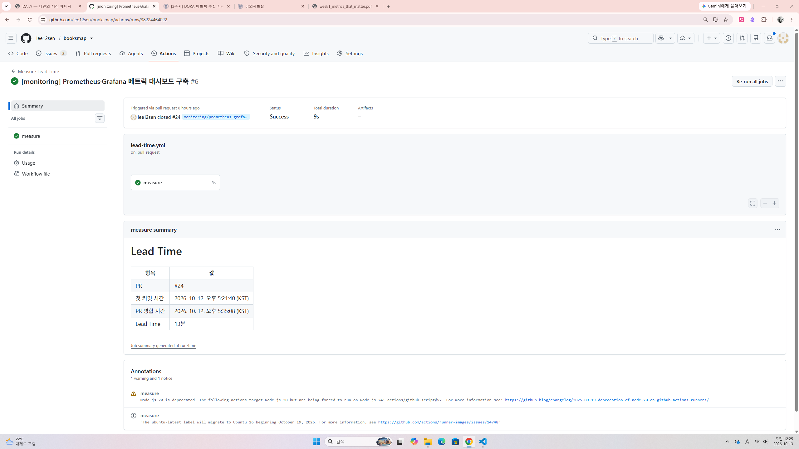
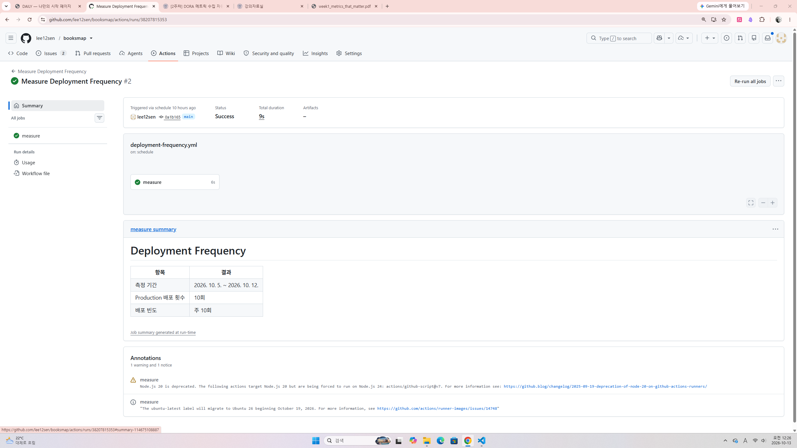
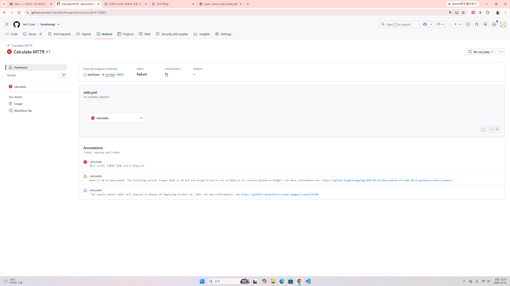
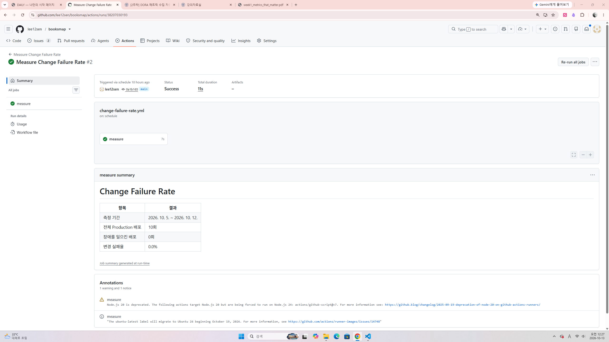

# 2주차 과제
## 과제 1 DORA Metrics 수집 자동화

### 각 워크플로우 파일
- [Lead Time](../.github/workflows/lead-time.yml)
- [Deployment Frequency](../.github/workflows/deployment-frequency.yml)
- [MTTR](../.github/workflows/mttr.yml)
- [Change Failure Rate](../.github/workflows/change-failure-rate.yml)

### 관련 문서

- [Lead Time 문서](../docs/workflows/lead-time.md)
- [Deployment Frequency 문서](../docs/workflows/deployment-frequency.md)
- [MTTR 문서](../docs/workflows/mttr.md)
- [Change Failure Rate 문서](../docs/workflows/change-failure-rate.md)

### 실행 성공 로그 스크린샷
#### Lead Time

#### Deployment Frequency

#### MTTR

#### Change Failure Rate

-----------

구현 방법: [README의 DORA 지표 워크플로우](../README.md#dora-지표-워크플로우)

-----------
